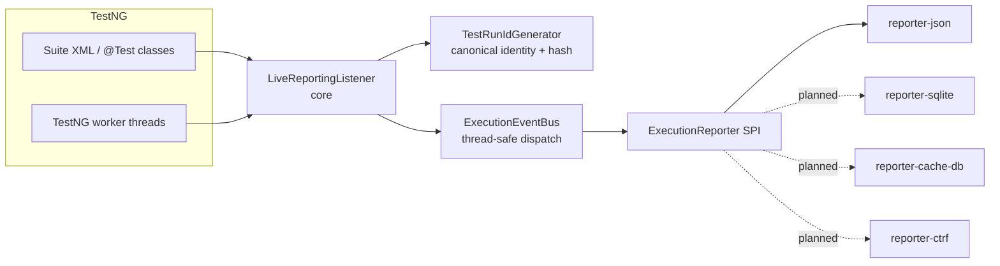
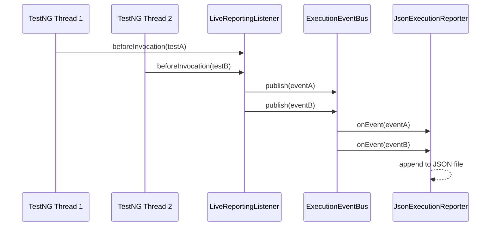
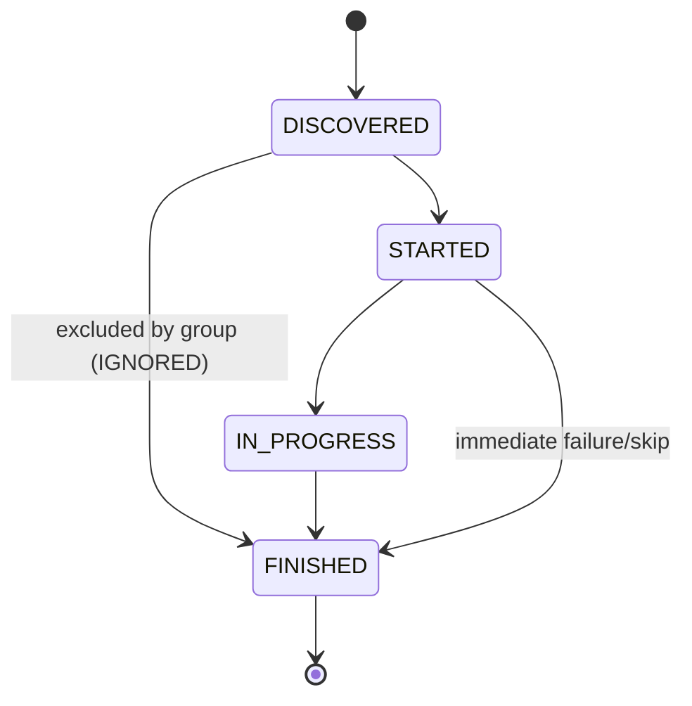
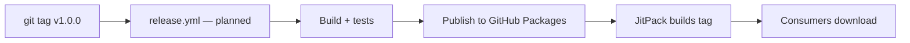

# 📡 testng-live-reporter

Live reporting listeners for **TestNG** execution traceability and observability.

> 🚦 **Status — design document / proposal**
>
> This README describes the planned shape of the project. No modules, listeners, or
> workflows are implemented yet. The first implementation milestone will deliver
> `core` + `reporter-json`; the remaining reporters are planned follow-ups.

---

## 🎯 Problem we are solving

When a TestNG suite runs—especially with parallel execution and data providers—the
only signals most teams get are console logs and a final report. It is hard to answer
simple questions while tests are still running:

- Which tests are currently executing?
- How many are queued, completed, passed, failed, skipped, or ignored?
- Which data-provider invocation or parallel instance produced a given event?
- Can another local tool consume the execution stream safely in real time?

This project provides **live execution listeners** that expose a consistent,
thread-safe stream of events describing test flow and outcome, so both humans and
other tools can understand what is happening *right now*.

### 🤖 Future AI-agent use case

Because the events are deterministic, machine-readable, and written locally in real
time, a coding assistant could later ask questions like:

> "How is the test execution going?"

And receive an answer such as:

> "20 tests total: 12 completed, 5 pending, 3 in progress; 9 passed, 2 failed,
> 1 ignored."

That conversational interface is **out of scope for now**. What *is* in scope is
producing a reliable local event stream that could enable those integrations later.

---

## 🏆 Goals

### Primary goal

Provide TestNG listeners that emit accurate, real-time, thread-safe execution events
containing lifecycle state, outcome status, timing, and stable test identity.

### Secondary goals

- **Small artifacts** — each reporter ships in its own JAR with only its own backend
dependencies.
- **Pluggable backends** — start with JSON; later add SQLite, a local cached DB, and CTRF.
- **Parallel & data-provider support** — every event is attributable to the correct
method, parameter set, invocation, and thread.
- **Stable schemas** — event contracts and identifiers are versioned so consumers can
rely on them.
- **External registration** — listeners can be used from Maven dependencies, SPI,
external JARs, or the TestNG API.

### Non-goals (out of scope for now)

- Conversational AI interface or agent integration.
- Web dashboard, hosted service, or remote querying.
- Production observability backends such as OpenTelemetry, Jaeger, or Prometheus.

---

## 🏗️ Architecture

The architecture is a thin, non-blocking layer between TestNG and pluggable reporters.



### 🚀 Initial scope — core + reporter-json

The first milestone validates the API with a single reference reporter:

- `core` owns the listener hooks, state/status model, identity generation, event bus,
  and `ExecutionReporter` SPI.
- `reporter-json` implements the SPI and writes a live JSON execution stream.

Only after `core` + `reporter-json` are stable will SQLite, cached DB, and CTRF
reporters be added.

### Parallel-event flow



Reporters never block TestNG worker threads. Each reporter may keep its own queue or
buffer; slow reporters must not slow down tests.

---

## ⚙️ Execution event model

Every event has a **state** (where the test is in its lifecycle) and a **status**
(its outcome). They are independent until the test finishes.

### State model (lifecycle)

| State | Meaning | Terminal? |
|---|---|---|
| `DISCOVERED` | The test method is present in the parsed suite/model. Emitted once per method from `onStart(ITestContext)`. | No |
| `QUEUED` | **Reserved — never emitted.** TestNG exposes no callback between discovery and `onTestStart`, so publishing it would mean inventing a transition. | No |
| `STARTED` | TestNG called `beforeInvocation` for this attempt. Emitted once per attempt. | No |
| `IN_PROGRESS` | The method body is actively executing. | No |
| `FINISHED` | No further execution events will occur for this attempt. | Yes |

`DISCOVERED` is synthetic in the sense that it is derived from the parsed model rather than
from an execution callback, but it reflects a real, checkable fact. `IN_PROGRESS` is captured
between `beforeInvocation` and `afterInvocation` hooks when available.

### Status model (outcome)

| Status | Meaning | Terminal? |
|---|---|---|
| `UNDETERMINED` | The test has not finished yet. | No |
| `PASSED` | `onTestSuccess` was invoked. | Yes |
| `FAILED` | `onTestFailure` was invoked, typically an assertion or unexpected exception. | Yes |
| `SKIPPED` | `onTestSkipped` was invoked (e.g., missing dependency or failed configuration). | Yes |
| `IGNORED` | The method was not executed because it is disabled or excluded by groups. | Yes |
| `TIMEOUT` | The test was terminated because it exceeded its timeout. | Yes |
| `INTERRUPTED` | The thread was interrupted before normal completion. | Yes |
| `ERROR` | The framework or listener could not determine a normal test outcome. | Yes |

`FAILED` vs `ERROR` is a best-effort classification: assertion failures are `FAILED`,
while infrastructure or unexpected framework problems are `ERROR`.

A configuration method (`@BeforeMethod`, `@BeforeClass`, `@After*`) that throws is reported
as a `test.event` with `FINISHED`/`ERROR` and `attributes.phase = "configuration"` — there is
no separate record type. The tests it prevented from running are reported as `SKIPPED`
separately, so the two records together explain each other. Configuration failures are
counted in `totals.configurationFailures` and excluded from `totals.tests`.

### State transition diagram



`QUEUED` is intentionally absent: it is reserved and never emitted.

---

## 🆔 Test and execution identifiers

Two identifiers are produced for every attempt:

- **`testId`** — stable identity of the test method and its canonical parameters.
- **`executionId`** — unique identifier for a single execution attempt within a run.

### Canonical identity

The human-readable identity is:

```text
package.TestClass.testMethod[canonicalParameters]
```

The canonical parameter form is deterministic across JVMs:

- `null` is serialized as `"null"`.
- Primitives and strings use their natural string form.
- Arrays are serialized recursively.
- Objects are serialized with a stable JSON/canonical representation; classes that
  rely on default `Object.toString()` (memory hash) are normalized using type + a
  deterministic field snapshot.

### Deterministic hash

A deterministic hash is appended to make long identities compact and indexable:

```text
package.TestClass.testMethod[canonicalParameters]#a1b2c3d4e5f6789a
```

The hash is the first **16 hexadecimal characters of SHA-256** over the canonical
identity payload. The full readable key is always retained for diagnostics.

### Execution identity

`executionId` combines the `testId` hash with run context to distinguish duplicate
values from data providers, factory instances, retries, and parallel threads:

```text
{runId}-{testIdHash}-{invocationIndex}-{retryAttempt}-{threadId}
```

This makes it possible to correlate every event with a unique execution attempt
without losing the stable identity of the underlying test.

---

## ⚡ Parallel execution, data providers, and retries

- **Parallel tests:** every event records the originating thread. The event bus uses
  non-blocking structures (`ConcurrentHashMap`, `BlockingQueue`) and never holds a
  lock while calling a reporter.
- **Data providers:** each invocation gets its own `executionId` and parameter set,
  so identical parameter values are still distinguishable by invocation index.
- **Retries:** each retry attempt is a new `executionId` sharing the same `testId`.
  The final TestNG result is recorded as a separate aggregate event.
- **Factories:** factory instance identity is included in execution context so
  multiple instances of the same class do not collide.

---

## 📁 Repository structure

### Module overview

| Module | ArtifactId | Purpose | Status |
|---|---|---|---|
| `core` | `testng-live-reporter-core` | Listener base, state/status model, identity generation, event bus, SPI | Implemented |
| `reporter-json` | `testng-live-reporter-json` | Live JSON execution stream + consolidated document | Implemented |
| `reporter-sqlite` | `testng-live-reporter-sqlite` | SQLite persistence | Planned |
| `reporter-cache-db` | `testng-live-reporter-cache-db` | Local cached DB (e.g. H2/MapDB) | Planned |
| `reporter-ctrf` | `testng-live-reporter-ctrf` | Common Test Report Format output | Planned |
| `integration-tests` | `testng-live-reporter-integration-tests` | E2E validation, dogfooding | Test-only, not published |

### Planned structure tree

```
testng-live-reporter/
├── pom.xml                                      # Parent POM: ${revision} versioning, dependency/plugin management
│
├── core/                                        # artifactId: testng-live-reporter-core
│   └── src/
│       ├── main/java/io/github/prmiguel/testng/live/core/
│       │   ├── LiveReportingListener.java       # TestNG listener entry point
│       │   ├── ExecutionEventBus.java           # Thread-safe fan-out to reporters
│       │   ├── TestRunIdGenerator.java          # Canonical identity + SHA-256 hash
│       │   ├── model/
│       │   │   ├── ExecutionState.java          # Lifecycle enum
│       │   │   ├── ExecutionStatus.java         # Outcome enum
│       │   │   ├── ExecutionEvent.java          # Immutable event record
│       │   │   ├── RunInfo.java                 # Run-level info for the SPI
│       │   │   └── TestIdentity.java            # Identity + run-context model
│       │   └── spi/
│       │       └── ExecutionReporter.java       # onEvent(...), onRunStarted/Finished, flush(), close()
│       ├── main/resources/META-INF/services/
│       │   └── org.testng.ITestNGListener       # SPI registration for auto-use
│       └── test/java/...                        # Unit + concurrency tests
│
├── reporter-json/                               # artifactId: testng-live-reporter-json        (depends: core)
│   ├── src/main/java/io/github/prmiguel/testng/live/json/
│   │   ├── JsonExecutionReporter.java            # Live NDJSON stream + consolidated document
│   │   ├── JsonReporterConfiguration.java        # Property/env/file configuration
│   │   └── spi/EventRecordEncoder.java           # Backend seam shared with future reporters
│   ├── src/main/resources/
│   │   ├── META-INF/services/…ExecutionReporter  # SPI registration
│   │   └── schema/testng-live-report-v1.schema.json
│   └── README.md                                 # Properties, formats, known limitations
│
├── reporter-sqlite/                             # Planned
├── reporter-cache-db/                           # Planned
├── reporter-ctrf/                               # Planned
│
├── integration-tests/                           # Test-only module
│   └── src/test/
│       ├── java/...                             # Parallel, data-provider, SPI E2E suites
│       └── resources/testng.xml
│
├── docs/
│   ├── jitpack-usage.md                         # Injecting the jars, no POM dependency
│   └── consumer-baby-steps.md                   # Step-by-step cookbook + Agent Skill
│
├── examples/jitpack-consumer/                   # Runnable consumer, reporter NOT in its pom
│   ├── pom.xml                                  # TestNG only, on purpose
│   ├── run.sh                                   # Fetch jars, compile, run, validate
│   └── src/main/java/demo/SmokeTest.java
│
├── .github/workflows/
│   ├── ci.yml                                   # Build, tests, dogfood + JitPack injection
│   ├── compatibility.yml                        # TestNG version matrix (schedule + manual)
│   ├── codeql.yml                               # CodeQL java-kotlin analysis
│   └── dependency-review.yml                    # Pull-request dependency review
│
└── README.md
```

---

## 🛡️ Standards and best practices

- **Java 21** baseline.
- TestNG is a `provided` dependency in every module.
- Event records are immutable.
- All timestamps are UTC with ISO-8601 formatting.
- Reporters are isolated from each other; one failing reporter must not affect others.
- Reporters never block TestNG worker threads.
- Canonical identity serialization is deterministic across runs.
- Event schemas carry their own `schemaVersion`, independent of the project version.
- Unit tests cover core behavior; concurrency tests cover parallel suites;
  integration tests dogfood `reporter-json`.
- CI uses least-privilege permissions, pinned actions, explicit timeouts, and
  concurrency controls.

---

## 🏷️ Versioning and compatibility

- **Unified Semantic Versioning** across all modules using the parent `${revision}`
  property plus `flatten-maven-plugin`.
- All modules released together with the same version, e.g. `1.0.0`.
- API and event-schema compatibility:
  - **Patch** (`1.0.x`) — bug fixes only, no contract changes.
  - **Minor** (`1.x.0`) — additive changes, backward compatible.
  - **Major** (`x.0.0`) — breaking changes to public API or event schema.
- Event `schemaVersion` is bumped when the event structure changes in a
  non-backward-compatible way. The current version is **2**; `v1` stays published because
  the record shapes are unchanged.

---

## 📦 Publishing

### GitHub Packages

Snapshots and releases are published to GitHub Packages:

```xml
<dependency>
    <groupId>io.github.prmiguel</groupId>
    <artifactId>testng-live-reporter-json</artifactId>
    <version>1.0.0</version>
</dependency>
```

GitHub Packages requires authentication in `~/.m2/settings.xml`.

### JitPack

Built on demand from a tag, branch, or commit hash — no authentication needed.
`jitpack.yml` selects JDK 21 (the default image ships JDK 17, which cannot compile
`release 21`) and runs the build through the committed Maven wrapper.

For a multi-module project the group is `com.github.<user>.<repo>` and the artifact is
the module artifactId:

```xml
<dependency>
    <groupId>com.github.prmiguel.testng-live-reporter</groupId>
    <artifactId>testng-live-reporter-json</artifactId>
    <version>1.0.0</version> <!-- a tag, branch-SNAPSHOT, or commit hash -->
</dependency>
```

Depend on `com.github.prmiguel:testng-live-reporter` instead to pull in every module.
JitPack rewrites the internal module dependency to the same requested version, so a single
version resolves the whole graph. Note that a build only works for commits that already
contain `jitpack.yml`, and `1.0.0-SNAPSHOT` in the POM is replaced by the requested version
at publish time.

Prefer not to declare a dependency at all? [`docs/jitpack-usage.md`](docs/jitpack-usage.md)
shows how to inject the jars onto a classpath instead, and includes a runnable example in
[`examples/jitpack-consumer`](examples/jitpack-consumer).

New to the project? [`docs/consumer-baby-steps.md`](docs/consumer-baby-steps.md) is the
linear cookbook: download → copy → register → check → run → read and filter the output, plus
a ready-made Agent Skill you can drop into another repository.

---

## 🔌 External usage

### 1. Maven dependency + classpath

Add the reporter as a test dependency and let `ServiceLoader` attach it to the core
listener. The reporter is **not** an `ITestNGListener`, so it must not be declared in
`<listeners>`; see [`reporter-json/README.md`](reporter-json/README.md) for the full
property reference.

```xml
<dependency>
    <groupId>io.github.prmiguel</groupId>
    <artifactId>testng-live-reporter-core</artifactId>
    <version>1.0.0</version>
    <scope>test</scope>
</dependency>
<dependency>
    <groupId>io.github.prmiguel</groupId>
    <artifactId>testng-live-reporter-json</artifactId>
    <version>1.0.0</version>
    <scope>test</scope>
</dependency>
```

If explicit registration is required, register the core *listener* only:

```xml
<listeners>
    <listener class-name="io.github.prmiguel.testng.live.core.LiveReportingListener"/>
</listeners>
```

### 2. SPI auto-registration

Place both JARs on the test classpath. Two service files do the work:
`META-INF/services/org.testng.ITestNGListener` (in `core`) makes TestNG load the listener,
and `META-INF/services/io.github.prmiguel.testng.live.core.spi.ExecutionReporter` (in
`reporter-json`) attaches the JSON reporter to it.

### 3. External JAR without editing project source

The cleanest way is to install the JAR into the local Maven repository and add it as
a test-scoped dependency:

```bash
mvn install:install-file \
  -Dfile=testng-live-reporter-json-1.0.0.jar \
  -DgroupId=io.github.prmiguel \
  -DartifactId=testng-live-reporter-json \
  -Dversion=1.0.0 \
  -Dpackaging=jar
```

Then declare the listener in `testng.xml` or rely on SPI.

Alternatively, run TestNG directly from the command line with the JAR on the
classpath:

```bash
java -cp "testng-7.x.jar:your-tests.jar:testng-live-reporter-json-1.0.0.jar" \
  org.testng.TestNG \
  -listener io.github.prmiguel.testng.live.json.JsonExecutionReporter \
  testng.xml
```

### 4. Programmatic registration

```java
TestNG testNG = new TestNG();
testNG.setTestClasses(new Class[]{MyTest.class});
testNG.addListener(new JsonExecutionReporter());
testNG.run();
```

---

## 🔄 GitHub Actions workflows

| Workflow | Trigger | Purpose |
|---|---|---|
| `ci.yml` | PR + push to `main` | Build, full test suite, dogfood reporter-json, validate emitted reports, JDK 21 |
| `compatibility.yml` | Schedule + manual | Test against supported TestNG versions (7.10.2, 7.11.0) |
| `codeql.yml` | PR + push to `main` + schedule | CodeQL analysis for `java-kotlin` |
| `dependency-review.yml` | PR only | Dependency vulnerability and license review |
| `snapshots.yml` / `release.yml` | — | Not implemented yet: the POM has no `distributionManagement`, so nothing is published |

Workflows follow secure defaults: least-privilege `permissions`, actions pinned to major
version tags, explicit `timeout-minutes`, Maven dependency caching, and artifact retention
limits. `ci.yml` additionally validates the real JSON output — a dogfood run writes both
files, then `.github/scripts/validate-reports.mjs` asserts every NDJSON line parses, the
record counts match the summary totals, no `(executionId, state)` pair repeats, and the
consolidated document splices exactly the streamed events.



---

## 🗺️ Roadmap

1. **Milestone 1** — `core` + `reporter-json`: listener hooks, event model,
   thread-safe bus, identity hashing, JSON output, unit + integration tests.
2. **Milestone 2** — CI/CD, publishing to GitHub Packages, JitPack availability,
   dogfood reporting in workflows.
3. **Milestone 3** — `reporter-sqlite`: persistent queryable execution history.
4. **Milestone 4** — `reporter-cache-db`: local in-memory/file-backed cache for
   live reads.
5. **Milestone 5** — `reporter-ctrf`: Common Test Report Format output.
6. **Future** — AI/query interfaces, dashboards, remote backends (not planned yet).
