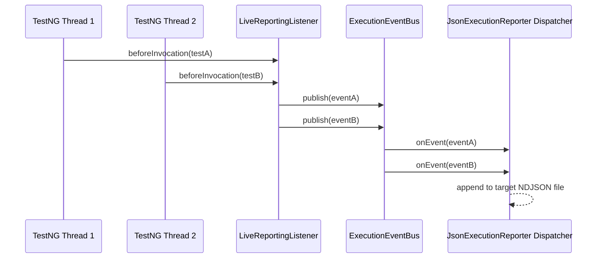
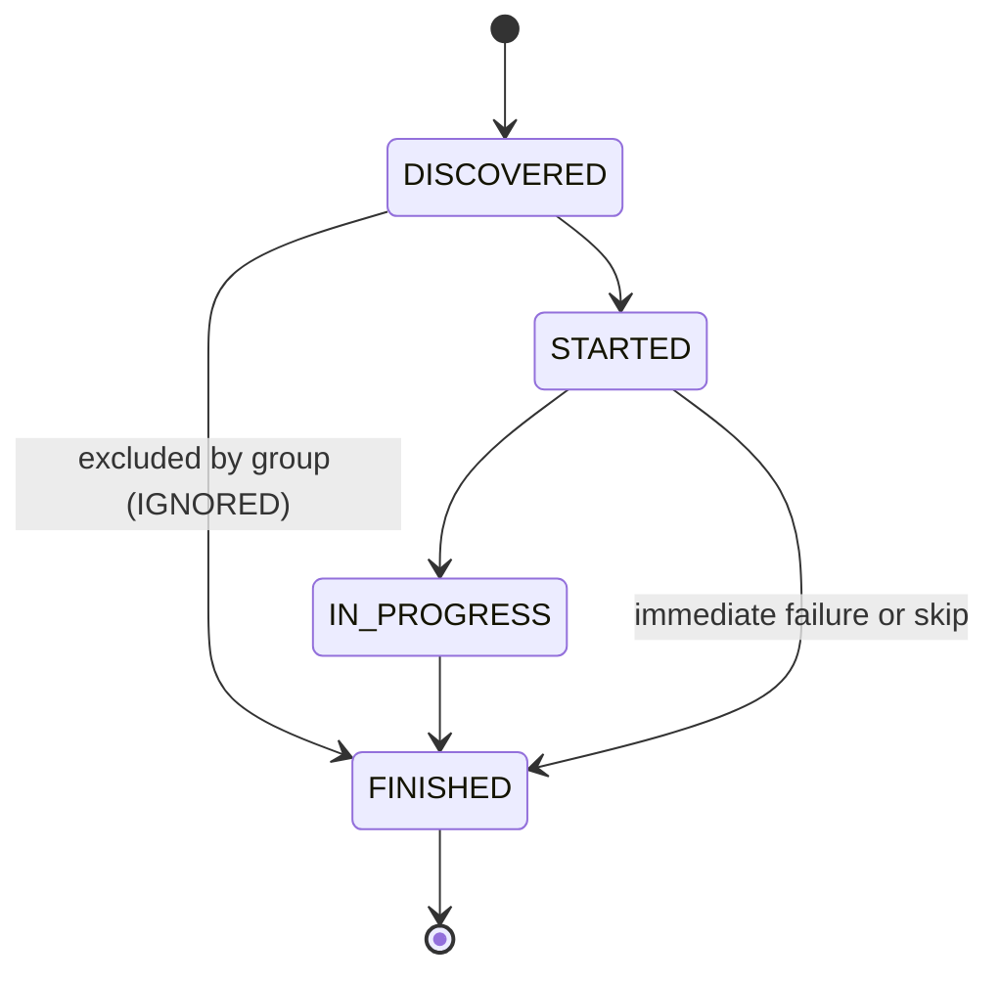

# 🏗️ Architecture & Event Model

This document outlines the core architecture, event model, lifecycle transitions, and identity generation mechanics of **TestNG Live Reporter**.

---

## 🏛️ High-Level Architecture

TestNG Live Reporter operates as a non-blocking bridge between TestNG's execution lifecycle and pluggable reporter implementations.

```mermaid
flowchart LR
    subgraph TestNG
        S[Suite XML / @Test classes]
        WT[TestNG worker threads]
    end

    subgraph Core [testng-live-reporter-core]
        L[LiveReportingListener]
        ID[TestRunIdGenerator<br/>canonical identity + SHA-256]
        EB[ExecutionEventBus<br/>thread-safe dispatcher]
        SPI[ExecutionReporter SPI]
    end

    subgraph Reporters [Reporters]
        JSON[reporter-json<br/>(Implemented)]
        SQL[reporter-sqlite<br/>(Planned)]
        CDB[reporter-cache-db<br/>(Planned)]
        CTRF[reporter-ctrf<br/>(Planned)]
    end

    S --> L
    WT --> L
    L --> ID
    L --> EB
    EB --> SPI
    SPI --> JSON
    SPI -.-> SQL
    SPI -.-> CDB
    SPI -.-> CTRF
```

### Key Components

- **`LiveReportingListener`**: Implements TestNG's lifecycle listener interfaces (`IExecutionListener`, `ISuiteListener`, `ITestListener`, `IInvokedMethodListener`, `IConfigurationListener`). Captures events without interfering with test execution.
- **`TestRunIdGenerator`**: Generates deterministic, human-readable canonical identities and 16-character SHA-256 hashes for tests, along with unique execution IDs for attempts.
- **`ExecutionEventBus`**: Dispatches immutable `ExecutionEvent` instances asynchronously. Each registered reporter receives events via its own single-thread dispatcher, ensuring reporters never block TestNG test worker threads.
- **`ExecutionReporter` SPI**: Simple plug-in interface (`onEvent`, `onRunStarted`, `onRunFinished`, `flush`, `close`) discovered via `java.util.ServiceLoader`.

---

## 🧵 Thread-Safety and Parallel Execution

TestNG test suites frequently run with `parallel="methods"`, `parallel="tests"`, or `parallel="classes"`, along with multi-threaded data providers.



### Guarantees

1. **Non-blocking execution**: Test threads only submit events to an in-memory queue. Heavy operations (e.g. disk I/O, serialization, network) happen on dedicated reporter threads.
2. **Context isolation**: Suite and test names are captured directly into immutable `ExecutionAttempt` instances from `ITestResult.getTestContext()`, eliminating cross-talk between interleaved test contexts.
3. **State transition guards**: `ExecutionAttempt` enforces that transitions (`markStarted()`, `markInProgress()`, `markFinished()`) succeed at most once, preventing duplicated callbacks from producing duplicate event states.

---

## ⚙️ Execution Event Model

Every event has a **state** (lifecycle phase) and a **status** (outcome). They remain independent until the test reaches a terminal state.

### Lifecycle State Model

| State | Description | Terminal? |
|---|---|---|
| `DISCOVERED` | Method is present in the parsed test context. Emitted once per method from `onStart(ITestContext)`. | No |
| `QUEUED` | *Reserved — never emitted.* TestNG has no callback between discovery and execution start. | No |
| `STARTED` | TestNG called `beforeInvocation` for this attempt. | No |
| `IN_PROGRESS` | The test method body is actively executing. | No |
| `FINISHED` | Execution has concluded for this attempt; no further events will be emitted for it. | Yes |

### Outcome Status Model

| Status | Description | Terminal? |
|---|---|---|
| `UNDETERMINED` | The test execution has not concluded yet. | No |
| `PASSED` | `onTestSuccess` was triggered. | Yes |
| `FAILED` | Assertion error or expected check failed (`onTestFailure`). | Yes |
| `SKIPPED` | Method skipped due to unmet dependencies or configuration failure (`onTestSkipped`). | Yes |
| `IGNORED` | Method excluded by group or disabled via annotation. | Yes |
| `TIMEOUT` | Terminated because execution exceeded the declared TestNG timeout. | Yes |
| `INTERRUPTED` | Thread was interrupted prior to normal completion. | Yes |
| `ERROR` | Unexpected runtime exception or framework failure. | Yes |

### State Transition Diagram



### Configuration Method Failures

When a configuration method (`@BeforeMethod`, `@BeforeClass`, `@AfterMethod`, etc.) fails:
- It is emitted as a standard `test.event` with `FINISHED` state, `ERROR` status, and `attributes.phase = "configuration"`.
- Tests that are skipped as a result are emitted as `FINISHED` / `SKIPPED`.
- Configuration failures are tracked in `totals.configurationFailures` and kept distinct from `totals.tests`.

---

## 🆔 Test and Execution Identifiers

Two primary identifiers are generated for every test attempt:

1. **`testId`**: Stable identifier of the test method and its canonicalized parameters.
2. **`executionId`**: Unique identifier for a specific execution attempt within a test run.

### Canonical Test Identity

Readable canonical format:
```text
package.TestClass.testMethod[canonicalParameters]
```

Parameter canonicalization produces deterministic string representations across JVM runs:
- `null` becomes `"null"`.
- Primitives and Strings use their natural string representation.
- Arrays and nested structures are formatted recursively.
- Objects without reliable `toString()` implementations use a type and deterministic field snapshot.

### Deterministic SHA-256 Hash

A 16-character hexadecimal SHA-256 hash is computed from the canonical identity:
```text
package.TestClass.testMethod[canonicalParameters]#a1b2c3d4e5f6789a
```
> ℹ️ Note: Method annotations (like `@Test(groups=...)`) are stored in `test.annotations` but excluded from the hash computation, ensuring identity stability across metadata edits.

### Execution Identity Formula

To distinguish retries, data-provider invocations, factory instances, and parallel runs:
```text
{runId}-{testIdHash}-{invocationIndex}-{retryAttempt}-{threadId}
```
This guarantees complete event traceability while preserving links to the originating test method.
