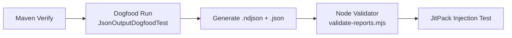
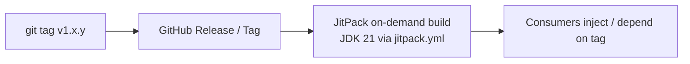

# 🔄 CI & Automation Workflows

This document describes the continuous integration, compatibility testing, and report validation pipeline for **TestNG Live Reporter**.

---

## 🤖 GitHub Actions Pipeline

| Workflow | Triggers | Purpose |
|---|---|---|
| `ci.yml` | Push to `main`, Pull Requests | Full build, unit & concurrency tests, dogfood run, JSON report validation, and JitPack injection verification. |
| `compatibility.yml` | Scheduled (weekly), Manual dispatch | Compatibility matrix against supported TestNG versions (`7.10.2` and `7.11.0`). |
| `codeql.yml` | Push to `main`, Pull Requests, Scheduled | Static code analysis via GitHub CodeQL for Java. |
| `dependency-review.yml` | Pull Requests | Automated dependency vulnerability and license review. |

---

## 🐶 Dogfooding & Output Validation

To guarantee report integrity, `ci.yml` runs a dedicated dogfood test and validates the real output using `.github/scripts/validate-reports.mjs`:



### The Validator Asserts:
1. Every line of the generated `.ndjson` stream is valid JSON.
2. The schema versions match expectations.
3. Event counts match summary totals exactly (`tests | length == totals.tests`).
4. No `(executionId, state)` pair is duplicated.
5. Consolidated `.json` contains exactly the aggregated attempts from the stream.

### Running the Dogfood Step Locally

Reproduce the exact CI validation locally:

```bash
# 1. Run the dogfood test with output directory set
mvn -B -ntp -pl reporter-json -am test -Dtest=JsonOutputDogfoodTest \
  -Dsurefire.failIfNoSpecifiedTests=false \
  -Ddogfood.output-dir="$PWD/reporter-json/target/dogfood"

# 2. Validate generated reports
node .github/scripts/validate-reports.mjs reporter-json/target/dogfood
```

---

## 🧪 JitPack Consumer Verification

The workflow executes `examples/jitpack-consumer/run.sh` to ensure:
- The compiled JARs can be resolved and injected without declaring dependencies inside the consumer's `pom.xml`.
- TestNG automatically detects the reporter and outputs valid NDJSON and JSON reports.

---

## 📦 Publishing Architecture



- **JitPack**: Available automatically on-demand via `com.github.prmiguel.testng-live-reporter:<module>:<version>`. Configured using `jitpack.yml` to compile with JDK 21.
- **GitHub Packages**: Target repository for release artifacts using unified semantic versioning (`${revision}`).
